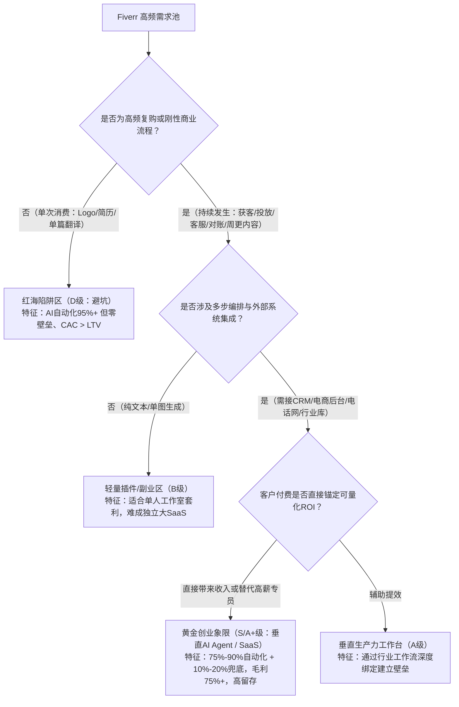

# Fiverr 全品类需求拆解：高 AI 自动化与高创业前景赛道深度调研报告

> [!IMPORTANT]
> **核心研判（“Unbundling Fiverr” 创业逻辑）**：Fiverr 正在经历剧烈的 **K 型分化**——低客单、单点交付的传统技能（基础翻译、泛 SEO 软文、简单抠图、普通 Logo）已被通用大模型直接消解，沦为 \$5–\$15 的红海陷阱；而**跨工具编排、直接绑定商业 ROI、高频持续发生的复杂 B2B 服务**（单笔 \$1,000+ 订单 GMV 同比增长 22.8%，买家年均支出升至 \$342+）正在爆发。**真正的 AI 创业金矿，是将 Fiverr 上高频复购的 B2B 外包服务拆解出来，重构为“垂直行业 AI Agent + 结果订阅制 SaaS”。**

---

## 一、 平台大盘趋势与真实需求信号（2025–2026）

结合 Fiverr 财报披露数据与官方 *Business Trends Index* 趋势报告，当前海外中小微企业（SMB）、跨境电商与创作者在 Fiverr 上的采购行为呈现四大结构性信号：

1. **AI Agent 与业务流编排需求爆发**：企业搜索 **AI Agent 相关搭建与托管服务** 的热度激增 **18,347%**。中小企业主不缺大模型账号，缺的是能把 LLM 稳定接入自家电话、WhatsApp、CRM（HubSpot / GoHighLevel）、Shopify 和数据库的自动化系统。
2. **搜索流量入口重构催生 GEO（生成式引擎优化）**：**67% 的搜索营销服务商**反馈客户急切要求优化品牌在 ChatGPT、Perplexity、Claude 及 Google AI Overviews 中的提及率与推荐权重，传统 SEO 预算正在向 GEO 迁移。
3. **视频与电商视觉工业化需求高企**：**AI 视频制作与混剪需求增长 66%**。TikTok Shop、Meta 投放与无脸频道（Faceless YouTube）买家不再追求单条精雕细琢，而是追求低成本批量生成高转化 UGC 广告、多语种口型对齐译制与商品场景图。
4. **“Vibe Coding” 投产救火成为技术新刚需**：大量非技术创始人借助 Cursor / Claude Code / Lovable 生成了 80% 的应用原型，却卡在鉴权漏洞、支付回调、数据库并发与云端部署的“最后 20%”，催生了高客单的代码审计、修 Bug 与上线托管需求。

---

## 二、 Fiverr 十大一级类目全景扫描（AI 自动化率 vs. 创业前景）

下表涵盖 Fiverr 全部核心一级大类（含摄影视觉子域），拆解各品类的真实需求结构、AI 自动化上限以及独立创业价值：

| 一级大类 | 平台核心细分需求 | 典型客单价 (USD) | 复购/订阅属性 | AI 自动化率 | 红海避坑区（高自动化但无壁垒） | 蓝海创业金矿（高自动化 + 高壁垒） | 创业前景评级 |
| :--- | :--- | :--- | :--- | :--- | :--- | :--- | :--- |
| **1. AI Services** *(AI 原生服务)* | AI 语音/聊天客服 Agent、n8n/Make 编排、企业 RAG 知识库、ComfyUI 管线、Vibe Coding 修复 | \$250 – \$2,500+ *(含月度运维费)* | **极高** *(接口维护/调优)* | **80% – 92%** | 代写通用 Prompt、简单套壳单页 GPT Bot、泛娱乐 AI 换脸生图 | **垂直行业语音销售/预约 Agent、企业私有知识库运维、垂类多模态工作流 SaaS** | **S 级** |
| **2. Video & Animation** *(视频与动画)* | 短视频切片、AI 数字人/UGC 带货广告、无脸频道全包、多语种配音字幕、产品演示动画 | \$100 – \$1,500 | **高** *(按周/按 SKU 持续产出)* | **75% – 90%** | 单纯自动加字幕、毫无审美逻辑的模板化拼接短视频 | **电商 SKU 转带货视频投放引擎、长播客自动裂变多平台矩阵、短剧/课程多语种译制（含 Lip-Sync）** | **S 级** |
| **3. Digital Marketing** *(数字营销)* | SEO / 本地 SEO、GEO 优化、B2B 冷邮件获客、社媒代运营、红人建联、电商广告投放 | \$200 – \$2,000/月 | **极高** *(天然按月 Retainer)* | **75% – 88%** | 群发垃圾外链、纯 AI 洗稿堆砌关键词博客、僵尸粉互动 | **GEO 品牌可见度监测与语料工程、基于购买信号的 B2B 自动获客 Agent、本地商户评价与本地 SEO 托管** | **S 级** |
| **4. Programming & Tech** *(编程与技术)* | Shopify/WordPress 二开、SaaS MVP 开发、Vibe Coding 救火、API 集成、自动化测试与安全审计 | \$300 – \$5,000+ | **中高** *(运维/迭代/监控)* | **65% – 85%** | 简单静态展示页切图、纯基础脚本代写（已被 AI 编程工具替代） | **AI 生成代码的安全审计与一键投产 Agent、自动化 E2E 回归测试 SaaS、老旧系统/电商插件迁移工具** | **A+ 级** |
| **5. Data** *(数据服务)* | 网页爬虫、B2B 销售名单挖掘与清洗、PDF/票据结构化提取、BI 看板搭建、模型评测标注 | \$100 – \$1,200 | **高** *(动态数据持续监控)* | **85% – 95%** | 手工 Excel 录入、一次性静态公开名录倒卖 | **抗反爬行业情报实时监控 API、非结构化医疗/物流/贸易单据自动核验引擎** | **A+ 级** |
| **6. Finance** *(财务与金融)* | 中小企业记账对账（QuickBooks/Xero）、电商多平台税务核算、融资财务模型、商业计划书 | \$200 – \$1,800/月 | **极高** *(月度/季度刚性合规)* | **75% – 88%** | 套模板生成泛泛而谈的商业计划书文字 | **多渠道跨境电商自动对账与异常核销 Agent、SMB 智能票据归类与预记账工作台** | **A+ 级** |
| **7. Graphics & Design** *(平面与摄影视觉)* | Logo/VI、电商主图与亚马逊 A+ 页、虚拟模特换装、房产虚拟软装（Virtual Staging）、Pitch Deck、UI/UX | \$50 – \$1,200 | **中** *(电商上新/地产挂牌高频，Logo 低频)* | **70% – 90%** | \$5–\$20 基础 Logo、背景抠图、Midjourney 单张插画代生成 | **电商白底图一键转全套高转化场景/模特穿戴图、房产空房一键合规软装渲染、数据驱动融资 Deck 生成** | **A 级** |
| **8. Business & Consulting** *(商业运营与咨询)* | 虚拟助理（VA）、CRM 搭建管理、合同起草审查、选品与供应链寻源、商标注册辅助 | \$150 – \$1,500 | **中高** *(日常运营支持)* | **65% – 80%** | 通用行程安排、泛市场调研摘要报告 | **特定行业（律所/诊所/猎头）前台中台自动化、合规合同预审与风险比对、跨境自动选品上架（如 AutoDS 模式）** | **A 级** |
| **9. Writing & Translation** *(写作与翻译)* | 博客文章、广告销售文案、多国语言本地化、简历求职信、政府补贴/招投标书（Grant/RFP）、技术文档 | \$30 – \$1,000 | **中低** *(除多语种出海与内容代运营外多为单次)* | **85% – 95%** | **重灾区**：普通文章撰写、通用中英互译、语法润色、单次简历修改（彻底卷向低价） | **企业级招投标书（RFP/Grant）RAG 自动应答系统、游戏/短剧/App 结合上下文的多语种文化转译管线** | **B+ 级** *(仅限高壁垒子类)* |
| **10. Music & Audio** *(音乐与音频)* | 真人/AI 配音、有声书录制、播客后期剪辑降噪、混音母带、品牌音效定制 | \$30 – \$600 | **中** *(播客周更复购强)* | **75% – 90%** | 普通英文旁白配音、基础背景音乐生成（被 ElevenLabs / Suno 直接冲击） | **播客全自动后期工程（降噪+去口水词+音平标准化+Shownotes+切片）、有声书多角色情感演播管线** | **B 级** |

---

## 三、 “AI 自动化率 × 创业前景”战略决策矩阵

> [!WARNING]
> **切勿把“AI 自动化率极高”等同于“适合创业”！**
> 凡是**单步 Prompt 即可完成、无上下文状态依赖、面向散户一次性消费（C 端低频）**的需求（如改简历、抠图、普通翻译、画头像），即便 AI 自动化率高达 98%，也会迅速被基础大模型原生吸收，导致获客成本（CAC）远高于客户终身价值（LTV）。

### 判断“真创业赛道”的五条硬指标
1. **按结果计价而非按工时计价**：客户愿意为“每月预约 30 个合格装修客户”付 \$1,000，而不愿为“配置一个聊天机器人”付 \$50。
2. **输入源源不断（Recurring Input）**：每周有新播客、每天有新询盘、每月有新银行流水、每季有新 SKU 上架——天然支撑 MRR（月经常性收入）。
3. **跨系统“最后一公里”执行**：不仅生成内容，还直接写入 HubSpot / Shopify / QuickBooks / TikTok Ads，迁移成本极高。
4. **85% AI 自动化 + 15% Human/Rule-in-the-Loop（关键校验层）**：在医疗预约、财税对账、代码投产、多语种广告等场景，企业为“99.9% 不出错的确定性”买单。
5. **数据飞轮效应**：行业术语库、高转化广告脚本结构、历史对账规则越用越准，通用模型无法开箱即用替代。

---

## 四、 8 大最具创业前景的高自动化赛道深度拆解

### 赛道 1：GEO（生成式引擎优化）与 AI 搜索品牌声量引擎
* **对应 Fiverr 类目**：Digital Marketing -> SEO / Content Marketing（当前增长最迅猛的新物种）
* **客户痛点**：欧美 SaaS、消费品牌、B2B 服务商发现传统 Google 点击率下滑，大量高意向买家直接问 ChatGPT / Perplexity *“Best CRM for dental clinics”*，但品牌完全不知道自己是否被推荐、为何落后于竞品。
* **AI 自动化工作流（自动化率 ~85%）**：
  1. **多模型探针集群**：定时以数百个行业买方意图词轮询主流 AI 搜索与大模型，量化品牌提及率（Share of Model）、情感倾向与引用信源 URL。
  2. **信源逆向分析**：自动拆解大模型高频采信的第三方评测站、Reddit 讨论串、G2/Capterra 评价、行业百科与高权重对比文。
  3. **结构化语料生成与分发**：自动生成符合 LLM 检索偏好的结构化对比页（Schema / `llms.txt` / 事实数据表）、公关稿与社区洞察草稿，自动推送到 CMS 并持续监控排名跃升。
* **商业模式**：B2B SaaS 订阅（\$199 – \$999/月）+ 高客单托管包（\$1,500+/月）。

### 赛道 2：本地服务业 60 秒极速响应 AI 语音与全渠道销售 Agent（Speed-to-Lead）
* **对应 Fiverr 类目**：AI Services -> AI Agents / Chatbots & Voicebots
* **客户痛点**：北美家装维修（HVAC/屋顶/管道）、医美牙科诊所、房产经纪、律所投流获客成本极高（单条线索 \$50–\$200），但因人工漏接电话或隔天回复，80% 线索流失。Fiverr 上大量买家花 \$500–\$1,500 找人用 Vapi / Retell + n8n + GoHighLevel 拼装外呼机器人。
* **AI 自动化工作流（自动化率 ~90%）**：
  1. **毫秒级触发**：网站表单、Meta Lead Ads 或未接来电进入瞬间，60 秒内自动发起低延迟拟真语音通话 + SMS/WhatsApp 双重触达。
  2. **行业脚本资格审查**：按垂直行业 SOP 询问预算、地址、紧急程度、保险类型，实时回答常见异议。
  3. **闭环派单**：自动查询技师/医生日历锁定时段、发送定金支付链接，并将通话结构化摘要写回行业 CRM（如 ServiceTitan / Clio / HubSpot）。
* **商业模式**：切入单一高毛利垂直行业，采用 **基础月费（\$399/月）+ 按成功预约绩效抽成**，客户 ROI 一目了然，续费率极高。

### 赛道 3：电商全套视觉资产与 AI UGC 投放素材工厂
* **对应 Fiverr 类目**：Video & Animation + Graphics & Design（E-Commerce Product Videos & Images）
* **客户痛点**：跨境与独立站卖家每上一个新 SKU，原本需在 Fiverr 分别找摄影师拍图、美工做亚马逊 A+ 详情页、网红拍 TikTok UGC 口播视频，周期 2–3 周、单品成本 \$500+，测款极慢。*(同类逻辑亦适用于房产经纪刚需的 **AI 空房虚拟软装 Virtual Staging**)*。
* **AI 自动化工作流（自动化率 ~85%）**：
  1. **卖点与爆款解构**：输入商品链接或白底图，自动抓取竞品高赞评论痛点与同品类 TikTok 爆款前三秒钩子（Hook）结构。
  2. **可控视觉合成**：保持商品几何细节与文字标签 100% 不变形的前提下，生成多族裔模特穿戴图、欧美真实家居场景图、信息图卖点卡。
  3. **批量视频广告生成**：生成多脚本数字人手持/穿戴展示 + B-roll 混剪 + 情绪配音 + 节奏卡点字幕，一次输出 10–20 条不同钩子的 AB 测试广告素材并直连广告后台验证点击率（CTR）。
* **商业模式**：按月度素材额度订阅（\$99 – \$499/月），高频刚需，天然适合中国供应链与全球独立站卖家双边市场。

### 赛道 4：面向“Vibe Coding”与中小团队的代码安全审计与一键投产 Agent
* **对应 Fiverr 类目**：Programming & Tech -> Software QA / Cybersecurity / Vibe Coding Rescue
* **客户痛点**：AI 编程普及后，数以百万计的产品经理、独立开发者和中小企业主能自己写出前端与基础后端，但在上线前陷入瘫痪：Supabase 行级安全策略（RLS）未配导致拖库、API Key 硬编码泄漏、Stripe Webhook 重复扣款、高并发崩溃。他们在 Fiverr 高价雇高级工程师做“上线前体检与部署”。
* **AI 自动化工作流（自动化率 ~80%）**：
  1. **深度静态+动态扫描 Agent**：接入 GitHub 仓库与预览环境，专精识别 AI 生成代码的高频缺陷模式（越权访问、注入漏洞、账单爆炸死循环、支付幂等缺失）。
  2. **自动生成修复 PR 与回归测试**：自动编写修复补丁与 Playwright 端到端关键链路测试（注册->登录->付费->核心功能），在沙箱跑通验证。
  3. **合规托管上线**：一键配置生产级监控告警、速率限制（Rate Limit）与备份策略。
* **商业模式**：按项目上线体检收费（\$99/次）+ 持续安全与自动化回归监控订阅（\$49–\$199/月），极具工程技术壁垒。

### 赛道 5：出海短剧、知识课程与品牌视频多语种精译引擎（音色克隆 + Lip-Sync）
* **对应 Fiverr 类目**：Video & Animation + Writing & Translation + Music & Audio
* **客户痛点**：短剧出海、YouTube 头部频道、企业全球培训课程需要译制成英、西、葡、日、阿、印尼等十余种语言。纯机器直译生硬尴尬、配音情绪假、嘴型对不上；全人工译制配音每分钟高达 \$20–\$50。
* **AI 自动化工作流（自动化率 ~88%）**：
  1. **多轨分离与说话人识别**：分离人声与背景音效（BGM/SFX 完整保留），精准识别多角色对话与情绪起伏。
  2. **本土文化俚语转译（Transcreation）**：基于目标国本土语料库与剧本上下文控制译文音节长度（匹配原片开口时长）。
  3. **情感音色克隆与口型重演**：克隆原演员声线并保留哭笑怒叹情绪，执行高精度视频面部口型同步（Lip-Sync），仅留极简时间轴供母语审校员 5 倍速抽检微调。
* **商业模式**：前期以高毛利 Productized Service 签短剧平台/MCN 年框，中期开放自助 SaaS 按分钟计费。

### 赛道 6：购买信号驱动的 B2B 情报挖掘与超个性化外呼/冷启动系统（Signal-Based Outbound）
* **对应 Fiverr 类目**：Data -> Data Scraping & Lead Generation + Digital Marketing
* **客户痛点**：Fiverr 上买静态企业邮箱列表早已失效（打开率 < 1%）。B2B 团队真正需要的是捕捉“当下正有采购意图”的动态信号（例如：某公司刚发布招海外运营岗位、刚拿到新一轮融资、某餐厅刚在 Google Maps 收到关于收银系统的差评、某工地刚获批市政施工许可）。
* **AI 自动化工作流（自动化率 ~90%）**：
  1. **7×24 行业异动爬虫与清洗**：实时监控招投标网、市政许可、招聘站、社媒吐槽、技术栈变更，自动补全关键决策人验证邮箱与 LinkedIn。
  2. **深度背景调研 Agent**：自动阅读目标公司最新动态，结合信号事件撰写“完全不像群发”的一对一破冰方案。
  3. **多通道自动跟进**：邮箱自动预热轮询发送 + 意向回复自动分级转交销售。
* **商业模式**：垂直行业获客订阅（\$299–\$1,200/月）或按有效商机结算，离钱最近，现金流回收极快。

### 赛道 7：B2B 创始人与专业机构“一鱼十吃”内容裂变工作台（Content Repurposing Ops）
* **对应 Fiverr 类目**：Video & Animation + Writing & Translation（Social Media Copy & Podcast Editing）
* **客户痛点**：欧美咨询合伙人、SaaS 创始人、播客主深知 LinkedIn / YouTube Shorts 个人 IP 获客价值，但没时间写稿剪片，常年在 Fiverr 支付 \$800–\$2,000/月雇佣自由职业团队做内容切片与代写。
* **AI 自动化工作流（自动化率 ~85%）**：
  1. **长内容注入**：自动拉取每周 Zoom 客户访谈、播客录音或行业直播。
  2. **个人文风知识库（Voice RAG）**：学习创始人历史高赞文章的句式、观点与禁忌词，拒绝“AI 味”套话。
  3. **多模态矩阵生成**：一键产出 5 条高光竖屏短视频（含自动人脸居中追踪与动态包装）、5 篇深度 LinkedIn 洞察帖、2 套精美 PDF 滑动轮播图（Carousel）与 1 篇周刊邮件，审批后自动定时发布。
* **商业模式**：极佳的“先做 \$1,000/月包月代运营，攒够 30 个客户后转为 \$149/月自助 SaaS”自举（Bootstrapping）项目。

### 赛道 8：多渠道电商与中小企业非结构化单据核销及预记账 Agent
* **对应 Fiverr 类目**：Finance -> Bookkeeping & Accounting + Data Processing
* **客户痛点**：同时经营 Amazon、Shopify、TikTok Shop、PayPal、Stripe 的卖家以及线下实体小微企业，每月面对海量异构结算单、退货扣费、物流发票与银行流水，人工对账耗时易错，Fiverr 专业簿记员按月收费高昂。
* **AI 自动化工作流（自动化率 ~88%）**：
  1. **多模态单据解析与拉取**：通过 API 与视觉大模型自动解析 PDF 发票、拍照收据、各平台结算报表。
  2. **智能科目映射与差额追查**：自动匹配订单级收入、平台佣金、广告费、汇率损益与银行实收款，精准定位异常漏款或重复扣费（甚至自动生成平台申诉工单追回赔付）。
  3. **一键入账**：生成合规凭证直推 QuickBooks / Xero，会计师仅需处理 5% 边缘异常项。
* **商业模式**：按订单量阶梯订阅（\$99–\$599/月）或按“成功追回平台异常扣费比例”分成，客户生命周期长达数年。

---

## 五、 从 0 到 1 创业落地路径：Service-to-Software 三步法

不要一上来闭门造车写半年通用 SaaS，建议利用 Fiverr 已经验证的需求池采用 **“服务先行，软件收割”** 策略：

| 阶段 | 时间周期 | 核心动作 | 关键验证指标 |
| :--- | :--- | :--- | :--- |
| **Phase 1：产品化服务冷启动** *(Productized Service)* | 第 1 – 2 个月 | 选定上述 1 个细分垂直切口（如“北美家装公司 60 秒语音跟单系统”或“独立站 GEO 排名优化包”），在 Fiverr Pro / Upwork 或冷邮件直接售卖**固定价格、固定交付标准的结果包**（\$500–\$1,500/单或包月）。后台用现有 API + 脚本 + 20% 人工兜底快速交付。 | 拿到 **10–20 个真实付费 B2B 客户**，实现首月正向现金流，摸清所有真实的脏数据与异常边界（Edge Cases）。 |
| **Phase 2：内部 Agent 管线化** *(Internal Dogfooding)* | 第 3 – 4 个月 | 将 Phase 1 中最耗人工的步骤沉淀为私有 Agent 编排引擎与审核后台，把单客户人工介入时间从 5 小时压缩到 15 分钟以内。 | 服务毛利率从外包水平的 30%–40% 拉升至 **软件级毛利（75%–85%+）**，单人可同时服务 50+ 活跃企业客户。 |
| **Phase 3：垂直 AI SaaS 独立化** *(Self-Serve Platform)* | 第 5 – 12 个月 | 将内部后台包装为面向终端客户或垂直代运营机构（Agency）的自助式 SaaS 平台，打通行业原生 CRM/ERP 插件市场，脱离接单平台建立自有品牌与经常性订阅壁垒。 | 形成稳定的 **MRR 增长飞轮** 与行业私有数据集，具备独立融资或高现金流稳健分红能力。 |

---

## 六、 本地配套数据表说明

除本深度报告外，已同步在本地生成结构化全景评分表 [fiverr_categories_matrix.csv](file:///Users/shuozheng/vllm/fiverr_research/fiverr_categories_matrix.csv)，包含 **28 个具体细分方向** 的客单价、复购率、AI 自动化比例、技术栈、竞争风险与创业评级，可直接用 Excel / Numbers 打开筛选，或通过 Google Sheets 的 `文件 -> 导入` 一键生成在线多维看板。
